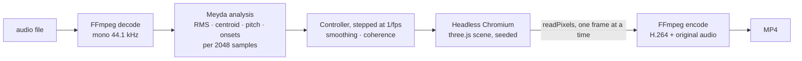

# voice-garden-render — turn any song into a particle music video

One command: audio in, MP4 out. Rendered offline frame by frame, so there are no dropped frames however long the track, and the same input always gives the same video. If it saves you an afternoon in a video editor, a ⭐ helps other people find it.


**Also an agent skill.** `npx skills add Lyrapower/voice-garden-render`, then ask Claude Code (or another agent that reads `SKILL.md`) for "a music video for this song, sunset colours, vertical". The skill picks the palette and size from what you say, renders, and checks the file before handing it over: [`skills/voice-garden-render/SKILL.md`](skills/voice-garden-render/SKILL.md).

```bash
git clone https://github.com/Lyrapower/voice-garden-render && cd voice-garden-render
npm install && npx playwright-core install chromium
npx voice-garden-render examples/demo.m4a -o demo.mp4
```

Needs Node.js 20+ and [FFmpeg](https://ffmpeg.org/download.html) on your `PATH`. Both example tracks are generated from code and CC0: `examples/demo.m4a` (24 s synth, [`examples/make-demo-audio.mjs`](examples/make-demo-audio.mjs)) and `examples/dream-trance.mp3` (28 s, from Voice Garden's [`scripts/make-demo-track.py`](https://github.com/Lyrapower/voice-garden/blob/main/scripts/make-demo-track.py)), which the demo media below use.

[▶ Watch the 12-second demo with sound](docs/demo-landscape.mp4) · [vertical version, `--palette sunset`](docs/demo-vertical.mp4)

## Why

Audio visualizers that export video usually record the screen in real time: a ten-minute track takes ten minutes, any dropped frame stays in the file, and you cannot script it. Here the visuals are a pure function of the audio and a seed, so you can render on a laptop, a server or in CI, re-render one section, and get the same frames every time.

## Features

- **Any input FFmpeg reads** (mp3, wav, m4a, flac, ogg, even the audio track of a video); the output is H.264 + AAC MP4 with the original audio.
- **The [Voice Garden](https://github.com/Lyrapower/voice-garden) look**: up to 200k particles in a turning three-arm spiral that streams inward, with curl-noise turbulence, light trails and bloom, over a night sky with a planet's edge. Loudness and onsets drive brightness and glow; timbre (spectral centroid) leans the colours.
- **Palettes**: `deep-space` (navy, cyan, magenta, gold), `sunset`, `aurora`, `ember`, `ice`, or any four colours of your own. `--trails 0` and `--no-sky` for a plainer frame.
- **Frame-exact.** The audio is analysed up front with the same features and onset rule as the live app, then every video frame is rendered at exactly `i / fps`, in order. Same audio + same options + same seed = byte-identical frames (checked in the tests).
- **Any size and frame rate**: `--size 1080x1920` for vertical video, `--fps 60`, `--start`/`--duration` for a section.
- **Fails loudly.** A missing input, an audio-less file or a blank first frame (no WebGL) is an error with a reason, not an empty video and exit code 0.

## Usage

```text
Usage: voice-garden-render <audio> [options]

  -o, --output <file>      MP4 to write (default: <audio name>.mp4)
      --fps <n>            frames per second, 1-120 (default 30)
      --size <WxH>         even width x height, 16-4096 (default 1280x720; 1080x1920 for vertical)
      --particles <n>      1000-200000 (default 100000)
      --seed <n>           particle layout seed, integer (default 1); same seed + same audio = same video
      --bloom <x>          glow strength 0-3 (default 1)
      --palette <p>        deep-space | sunset | aurora | ember | ice, or four colours rim to core:
                           "#1a2985,#1fc7f2,#eb1fb8,#ff991f" (default deep-space)
      --trails <x>         light-trail persistence 0-0.95, 0 = off (default 0.8)
      --no-sky             plain dark background instead of the night sky
      --start <sec>        start offset in the audio (default 0)
      --duration <sec>     length to render (default: to the end)
      --browser-path <p>   Chromium executable (default: Playwright's; env VGR_BROWSER)
      --software           force software WebGL (SwiftShader), e.g. on machines without a GPU
      --hash-frames <json> write the sha256 of every frame to a JSON file
```

Examples:

```bash
npx voice-garden-render song.mp3                                   # song.mp4, 1280x720 at 30 fps
npx voice-garden-render song.mp3 --size 1080x1920 --fps 30 -o reel.mp4
npx voice-garden-render podcast.wav --start 60 --duration 30 --particles 50000
npx voice-garden-render song.mp3 --palette ember --trails 0 --no-sky
npx voice-garden-render song.mp3 --palette "#0b132b,#3a506b,#5bc0be,#f8f9fa"
```

**Speed** depends on the GPU. With no GPU (software WebGL in a 2-core cloud container, trails and sky on, 100k particles) it runs at about 2.9 s per frame at 640x360 and 2.7 s per frame at 960x540. A machine with a GPU is much faster; numbers from real hardware are welcome in an issue.

## How it works



No clocks and no `requestAnimationFrame`: the CLI hands the scene one frame's state, the scene renders it, and the raw pixels go straight into FFmpeg.

## Tests

```bash
npm test
```

Unit tests cover the audio analysis (silence, pitch, onsets), the frame driver, palettes and argument validation. The end-to-end test renders a real file twice with the same seed and checks the frames are identical, renders again with another seed and checks they differ, and probes the MP4's codecs and duration. It needs FFmpeg and a Chromium (`npx playwright-core install chromium`, or `VGR_BROWSER=/path/to/chromium`).

## Roadmap

- WebKit and Firefox engines through Playwright
- Lyrics and title overlays from an `.srt` / `.lrc` file
- Publish to npm so `npx voice-garden-render` works without cloning

## Contributing

Issues and pull requests are welcome; [`good first issue`](https://github.com/Lyrapower/voice-garden-render/labels/good%20first%20issue) marks small, self-contained ones. Please run `npm test` before opening a pull request.

## License

[MIT](LICENSE). The particle field comes from [Voice Garden](https://github.com/Lyrapower/voice-garden) (MIT).
